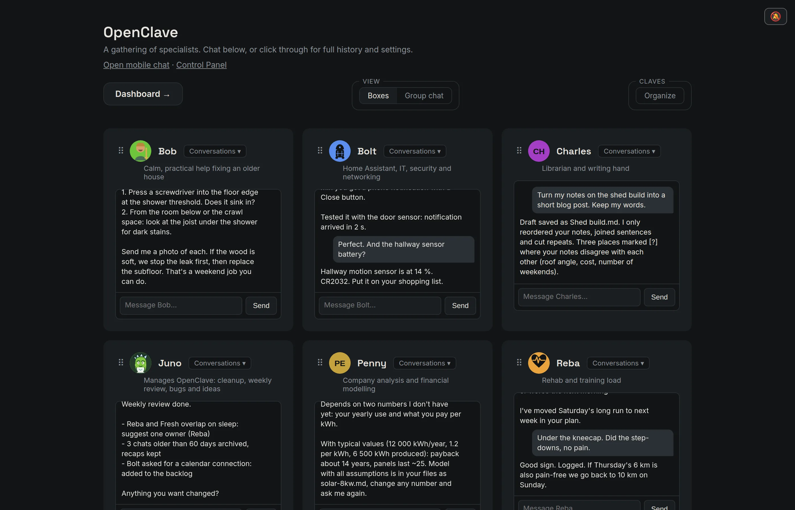

# OpenClave

AI chats get messy fast. OpenClave keeps them in order.

A chat app gives you one long list of conversations, and after a few months
you can't find the answer you got in March. OpenClave sorts your work into
**agents**, each with one area of your life (training, the house, money), and
each agent's chats into **topics**. A **manager** agent tidies up every week
and asks you before it changes anything.

It is private: it runs on your own computer (or a small home server), and
everything is a plain Markdown file you can read. You use it from a browser or
your phone. The thinking is done by a model you choose: an API key from
Anthropic or xAI, or the Claude or ChatGPT subscription you already pay for.



> **Status: early.** It works every day for its author, but you are among the
> first to install it from scratch. If a step below fails or confuses you,
> that's a bug: please report it (see [Feedback](#feedback)).

## Contents

**[Part 1: Easy setup](#part-1-easy-setup)**: [Install](#install) · [What it runs](#what-the-installer-runs) ·
[Your first agents](#your-first-agents) · [The openclave command](#the-openclave-command) ·
[Updating](#updating) · [Back up](#back-up) · [Remove OpenClave](#remove-openclave)

**[Part 2: Detailed setup](#part-2-detailed-setup)**:
[What you need](#what-you-need) · [Install by hand](#install-by-hand) ·
[Choosing a model](#choosing-a-model) · [Where your data lives](#where-your-data-lives) ·
[Optional extras](#optional-extras) (subscriptions, note search, phone, keep it
running, Windows (WSL), voice, Docker) · [Updating by hand](#updating-by-hand) ·
[Troubleshooting](#troubleshooting)

[Feedback](#feedback) · [For developers](#for-developers) · [Licence](#licence)

# Part 1: Easy setup

**You need** a computer running Ubuntu or Debian (or Windows with
[WSL](https://learn.microsoft.com/windows/wsl/install)), and one way to pay for
the AI: an [Anthropic API key](https://console.anthropic.com/) (pay per use, a
few dollars a month for light use), or the Claude Pro/Max or ChatGPT Plus/Pro
subscription you already have. A laptop is fine to try it; an always-on home
server or old PC is better for daily use.

## Install

Open a terminal and paste:

```sh
curl -fsSL https://getopenclave.com/install.sh | bash
```

Prefer git? This does the same:

```sh
sudo apt install -y git
git clone https://github.com/larslyse/openclave.git
cd openclave && ./install.sh
```

The installer asks a few questions (press Enter for the suggested answer):
what your agents should call you, your timezone, and how the agents think (it
checks your API key, or installs Claude or Codex and signs you in to your
subscription). It can add note search and start OpenClave with the computer.
Then it opens **http://localhost:8777/** (or the next free port, if another
program already uses 8777).

On a computer without a screen, which is the best setup for daily use, it
offers to make OpenClave reachable from your laptop and phone over a private
HTTPS address with [Tailscale](https://tailscale.com/), if Tailscale is set up
there. Otherwise it shows an `ssh` command to reach it, and you can set up the
phone later in **Control Panel → Phone**.

Run the installer again any time (`./install.sh` in `~/openclave`), for
example to add a model. It keeps your settings and agents.

### What the installer runs

Piping a script into `bash` means trusting it, so here is what
[`install.sh`](install.sh) does, in order. It runs as your normal user and only
uses `sudo` for the steps marked **(sudo)**.

1. **Checks** that you're on Ubuntu or Debian (or WSL), not root, with
   Python 3.12 or newer.
2. **Installs missing basics** with apt: git, curl, python3, python3-venv
   **(sudo)**.
3. **Downloads OpenClave** with `git clone` to `~/openclave`, or updates it
   there if it's already present (skipped when you run it from a clone).
4. **Installs its Python packages** into `~/openclave/.venv`. Nothing
   system-wide. Links the `openclave` command into `~/.local/bin`.
5. **Asks about you**: your name and timezone, saved to
   `~/.openclave/openclave.toml`.
6. **Asks about your manager agent**: its name, personality, any extra jobs,
   and changes to its job. Nothing is filled in for you; each question lists
   suggestions you can pick by number.
7. **Sets up a model**, the one you pick:
   - API key (Anthropic or xAI): checked against the provider, saved to
     `~/.openclave/.env` (only you can read it).
   - Claude Pro/Max: installs Claude Code from claude.ai and lets you sign in.
   - ChatGPT Plus/Pro: installs Node.js 22 (NodeSource), bubblewrap and the
     Codex CLI, plus an AppArmor rule on Ubuntu 24.04+ so Codex's sandbox
     works, then lets you sign in **(sudo)**.
8. **Asks which ready-made agents to start with** (none unless you pick
   some).
9. **Optional, asks first:** note search (qmd, through npm) **(sudo)**, and a
   systemd service `openclave.service` so it starts with the computer
   **(sudo)**.
10. **Picks the port**: the one in `openclave.toml` (8777 unless you set
    another). If another program uses it, it takes the next free one and
    saves it there (asks first if you already had settings).
11. **On a computer without a screen, asks first:** if Tailscale is signed
    in, runs `tailscale serve --bg <port>` for a private HTTPS address and
    saves it as `public_url` in `openclave.toml` (**(sudo)** if Tailscale
    needs it). On WSL it explains how to keep OpenClave running.
12. **Starts OpenClave** on http://localhost:8777/ and opens your browser.

Its only network use is downloading those packages and checking your API key
with its provider. To read it before running it:

```sh
curl -fsSL https://getopenclave.com/install.sh -o install.sh
less install.sh
bash install.sh
```

## Your first agents

The installer creates your **manager** with the name and personality you
chose, plus any ready-made agents you picked. The manager keeps the other
agents tidy, runs a weekly review and collects bugs and ideas. Every install
has exactly one. Open it first: it interviews you briefly. It starts with its
initials as a picture: pick one in **Control Panel → Edit → Pick from
library**, make your own, or ask it to draw one.

1. To add more, click **Create new specialist**. You land on the **New
   agent** form with a list of **ready-made agents** below it. (Installed by
   hand? Add the **Manager** from that list first and give it a name.)
2. Add a few for the areas you care about most. Each comes with a
   job and a personality, then interviews you for a few minutes to fit itself
   to you. Answer in your own words; you can always change it later. Prefer
   your own? Fill in **Name** and **What is it for?** at the top of the form
   instead.
3. Chat from the home page, or click an agent for its full page: chats, plan,
   backlog, files and settings.

About 5 to 10 agents works best: few enough that you always know whom to ask.
`catalog/README.md` explains how the ready-made agents fit together.

The **Control Panel** (link at the top of the home page) has everything else:
models per agent, tools, scheduled tasks, reminders, usage and the **Setup**
check.

## The openclave command

The installer adds an `openclave` command (open a new terminal if it isn't
found yet):

| Command | What it does |
|---|---|
| `openclave start` | Start it: as a service if it is installed as one, otherwise in this terminal (stop with Ctrl+C) |
| `openclave stop` / `restart` | Stop or restart it, e.g. after changing settings or keys |
| `openclave status` | Is it running, which version |
| `openclave logs` | Follow its log (when it runs as a service) |
| `openclave check` | What is set up: models, search, voice, phone |
| `openclave url` | Its addresses |
| `openclave update` | Get the latest version, see [Updating](#updating) |
| `openclave backup` | See [Back up](#back-up) |
| `openclave uninstall` | See [Remove OpenClave](#remove-openclave) |

## Updating

```sh
openclave update
```

It downloads the latest version (`git pull`), installs its Python packages and
restarts OpenClave if it runs as a service. It won't update a folder you
changed yourself. **Control Panel → Update** shows whether a newer version
exists and, when OpenClave runs as a service, can update it with one button.
Running `./install.sh` again also updates.

## Back up

```sh
openclave backup
```

writes one file, `~/openclave-backups/openclave-<date>.tgz`, with your
settings, keys, agents and chats (everything in `~/.openclave` except caches
and voice models, which download again). Only you can read it, because it
holds your keys: keep it somewhere private. If you set `vault_root` or
`agents_root` to a folder outside `~/.openclave`, that folder is **not** in
the backup; the command names it so you can back it up yourself. To restore,
unpack it in your home folder: `tar -xzf openclave-<date>.tgz -C ~`.

## Remove OpenClave

```sh
openclave uninstall
```

It lists what it will remove (the service, the `~/openclave` folder and the
`openclave` command) and asks first. It never deletes your agents, chats and
settings in `~/.openclave`: delete that folder yourself if you want them gone.
Note search, Node.js, Claude Code or Codex stay installed too.

## Something not working?

See [Troubleshooting](#troubleshooting), or ask the person who invited you.
`openclave check` shows what is set up, and `openclave logs` shows what
OpenClave printed.

# Part 2: Detailed setup

Everything the installer does, step by step, plus all the extras: for other
systems, for doing it by hand, or to understand what's where.

## What you need

| | |
|---|---|
| **Computer** | Linux (tested on Ubuntu 24.04) or Windows with WSL2 (Ubuntu); see [Windows (WSL)](#windows-wsl). macOS: the installer doesn't support it; installing by hand may work but is untested. Any machine that is on when you want to use it: a laptop is fine to try it out; a home server or old PC is better for daily use. |
| **Python** | 3.12 or newer, with `venv` (on Ubuntu: `sudo apt install python3-venv`). Check with `python3 --version`. |
| **git** | To download and update OpenClave. |
| **A model** | At least one of: an [Anthropic API key](https://console.anthropic.com/) (pay per use, easiest), an [xAI API key](https://console.x.ai/) (pay per use), a Claude Pro/Max subscription, or a ChatGPT Plus/Pro subscription. The subscriptions need one extra step ([below](#use-your-claude-or-chatgpt-subscription)). |
| **Disk, memory** | About 300 MB, plus your notes. 1 GB of free RAM is plenty. |

You do **not** need a GPU, Docker or a domain name. Node.js is only needed for
some optional extras.

## Install by hand

These commands are for Ubuntu/Debian and WSL. On other systems, install git and
Python 3.12+ your usual way and skip the first line.

**1. Install the basics and download OpenClave**

```sh
sudo apt update && sudo apt install -y git python3-venv
git clone https://github.com/larslyse/openclave.git
cd openclave
```

**2. Install OpenClave's Python packages** into a folder of its own (`.venv`),
so nothing on your system changes:

```sh
python3 -m venv .venv
.venv/bin/pip install -r requirements.txt
```

**3. Tell it who you are.** Settings live in `~/.openclave/openclave.toml`.
Replace the name and timezone ([list of timezones](https://en.wikipedia.org/wiki/List_of_tz_database_time_zones), e.g. `Europe/Oslo`, `America/New_York`):

```sh
mkdir -p ~/.openclave
cat > ~/.openclave/openclave.toml <<'EOF'
[owner]
name = "Alex"

[time]
timezone = "Europe/Oslo"
EOF
```

Every other setting has a sensible default. `openclave.example.toml` in this
folder lists them all with explanations.

**4. Add a model key.** Keys go in `~/.openclave/.env`, one per line. For an
Anthropic key:

```sh
echo 'ANTHROPIC_API_KEY=sk-ant-...your key...' >> ~/.openclave/.env
chmod 600 ~/.openclave/.env
```

(For xAI it's `XAI_API_KEY=...`. Using a subscription instead? Skip this step
and follow [Use your Claude or ChatGPT subscription](#use-your-claude-or-chatgpt-subscription).)

**5. Check the setup:**

```sh
.venv/bin/python run.py --check
```

You want at least one `[ok]` under **Models**. Everything under **Optional**
can stay off.

**6. Start it:**

```sh
.venv/bin/python run.py
```

Open **http://localhost:8777/** in a browser on the same computer. Stop it with
Ctrl+C. To keep it running after you close the terminal, see
[Keep it running](#keep-it-running).

Installed on a server without a screen? From your own computer, run
`ssh -L 8777:localhost:8777 you@your-server`, then open
http://localhost:8777/ on your own computer.

## Choosing a model

Each agent has its own model; change it on the agent's page or in the Control
Panel. Models are grouped by route:

| Route | You need | Cost | Notes |
|---|---|---|---|
| **API** (Anthropic, xAI) | API key in `~/.openclave/.env` | Pay per use. Light daily use of a few agents is typically a few dollars a month; heavy use more. | Fastest replies (2–5 s). Easiest to set up. |
| **CLI** (Claude, Codex) | The `claude` or `codex` program, signed in to your subscription | Included in your subscription, within its usage limits | Slower replies (10–30 s). Needed for some connections, such as Home Assistant. |

Models that aren't set up on your computer show as **not set up** in the
pickers. Set a spending limit in your provider's console if you use an API key.

## Where your data lives

| What | Where |
|---|---|
| Settings | `~/.openclave/openclave.toml` |
| Keys and tokens | `~/.openclave/.env` (keep it private) |
| Your agents: missions, notes, plans, chats | `~/.openclave/agents/`, one folder per agent, all Markdown |
| App state (model choices, usage, push devices) | `~/.openclave/state/` |

Back up `~/.openclave` and you have everything. To keep agents inside an
existing notes folder (an Obsidian vault, for example), set
`[paths] vault_root` and `agents_root` in `openclave.toml` (see
`openclave.example.toml`). Agents can then search and read your notes, and
write only where you allow them to.

**Privacy:** OpenClave itself sends nothing anywhere. What you write to an
agent, plus the notes it looks up, goes to the model provider you picked
(Anthropic, xAI, OpenAI) to produce the reply, under that provider's terms. By
default OpenClave only listens on this computer (`localhost`).

OpenClave looks for a newer version of itself every few hours (a `git fetch`
from where you installed it, shown in Control Panel → Update). Besides the
model provider, that is the only call OpenClave makes on its own. Turn it off
with `[updates] check = false` in `openclave.toml`.

## Optional extras

None of these are needed to start. `run.py --check` and **Control Panel →
Setup** show which are on.

### Use your Claude or ChatGPT subscription

Instead of an API key, agents can run through the official command-line tools,
on the subscription you already have. Install them **as the same user that
runs OpenClave**, then restart OpenClave.

**Claude (Pro or Max):**

```sh
curl -fsSL https://claude.ai/install.sh | bash
claude        # sign in when asked, then type /exit
```

Models marked `claude-cli` now work. If the sign-in expires, the Control Panel
says so and can sign you in again.

**ChatGPT (Plus or Pro), via Codex:**

Codex and note search need Node.js 22 or newer. Ubuntu 24.04's own package is
older, so install it from NodeSource (skip if `node --version` already says
v22 or later):

```sh
curl -fsSL https://deb.nodesource.com/setup_22.x | sudo -E bash -
sudo apt install -y nodejs
```

Then:

```sh
sudo apt install -y bubblewrap
sudo npm install -g @openai/codex
codex login   # on a server without a browser: codex login --device-auth
```

On **Ubuntu 24.04** Codex's sandbox also needs this one-time permission
(Ubuntu blocks the user namespaces it uses):

```sh
sudo tee /etc/apparmor.d/bwrap >/dev/null <<'EOF'
abi <abi/4.0>,
include <tunables/global>

profile bwrap /usr/bin/bwrap flags=(unconfined) {
  userns,
  include if exists <local/bwrap>
}
EOF
sudo apparmor_parser -r /etc/apparmor.d/bwrap
```

If `claude` or `codex` is installed somewhere OpenClave doesn't find it, set the
full path under `[cli]` in `openclave.toml`.

### Search your notes

With [qmd](https://www.npmjs.com/package/@tobilu/qmd) installed, agents can
search everything in your notes folder by keyword, not only the files they
already know about. It indexes your notes folder the first time an agent
searches.

It needs Node.js 22 or newer (see the Codex section above for how to install
it), then:

```sh
sudo npm install -g @tobilu/qmd
```

Notes written in more than one language? Set
`[owner] note_languages = ["English", "Norwegian"]`, and agents search in each.

### Use it from your phone

The phone app is at `/mobile/`. Phones need a secure (HTTPS) address for the
microphone and notifications, and OpenClave shouldn't be open to the internet.
The simplest way to get both is [Tailscale](https://tailscale.com/) (free for
personal use): a private network between your own devices.

1. Install Tailscale on the OpenClave computer and on your phone, and sign in
   to the same account on both.
2. In the Tailscale admin console, under **DNS**, turn on **MagicDNS** and
   **HTTPS certificates**.
3. On the OpenClave computer:

   ```sh
   sudo tailscale serve --bg 8777
   tailscale serve status        # shows your address, https://<name>.<tailnet>.ts.net
   ```

4. Add that address to `~/.openclave/openclave.toml` and restart OpenClave:

   ```toml
   [network]
   public_url = "https://<name>.<tailnet>.ts.net"
   ```

   **Control Panel → Phone** does steps 3 and 4 for you and shows a QR code
   for the phone.

5. On the phone, open `https://<name>.<tailnet>.ts.net/mobile/`, then use
   **Add to Home Screen**. Turn on notifications with the bell icon.

Anyone on your tailnet can reach it. To require a password-like token as well,
set `[network] access_token` (see `openclave.example.toml`).

### Keep it running

To start OpenClave at boot and restart it if it stops, run it as a systemd
service. Run this in the `openclave` folder (it fills in
`deploy/openclave.service.example`):

```sh
sed -e "s|__USER__|$USER|g" -e "s|__REPO__|$PWD|g" -e "s|__DATA__|$HOME/.openclave|g" -e "s|__HOME__|$HOME|g" \
    deploy/openclave.service.example | sudo tee /etc/systemd/system/openclave.service
sudo systemctl daemon-reload
sudo systemctl enable --now openclave
```

Then `systemctl status openclave` shows whether it runs, and
`journalctl -u openclave -f` shows its log. After changing settings or keys:
`sudo systemctl restart openclave`. (`openclave status`, `openclave logs` and
`openclave restart` do the same.)

### Windows (WSL)

OpenClave runs inside WSL (Ubuntu) like on Linux; open http://localhost:8777/
in your Windows browser. Two things differ (not yet tested on every setup):

- **systemd is off by default in WSL**, so OpenClave can't run as a service.
  To turn it on, add these lines to `/etc/wsl.conf` inside Ubuntu, then run
  `wsl --shutdown` in Windows PowerShell and open Ubuntu again:

  ```ini
  [boot]
  systemd=true
  ```

- **WSL stops when you close its last window**, and OpenClave with it. To
  start it each time you log in to Windows, run this once in PowerShell
  (replace `Ubuntu` and `you` with your distro and user name):

  ```powershell
  schtasks /create /tn OpenClave /sc onlogon /tr "wsl.exe -d Ubuntu -u you -- /home/you/.local/bin/openclave start --stay"
  ```

  This keeps a small window open while OpenClave runs; closing it stops
  OpenClave. The installer prints this line with your names filled in.

### Voice

Talk to agents and hear them answer, with speech recognition and speech
running locally on your computer (no extra cost). It needs about 1 GB of extra
downloads and a reasonably modern CPU.

```sh
.venv/bin/pip install -r requirements-voice.txt
mkdir -p ~/.openclave/models/voice && cd ~/.openclave/models/voice
curl -LO https://github.com/thewh1teagle/kokoro-onnx/releases/download/model-files-v1.0/kokoro-v1.0.onnx
curl -LO https://github.com/thewh1teagle/kokoro-onnx/releases/download/model-files-v1.0/voices-v1.0.bin
cd -
```

Then in `openclave.toml` (use the full path to your OpenClave folder) and
restart:

```toml
[voice]
python = "/home/you/openclave/.venv/bin/python"
model_dir = "models/voice"
```

The speech recognition model (Whisper `small`) downloads on first use. Voice
in the browser needs `localhost` or HTTPS (see the phone section).

### Docker

If you prefer containers: `docker compose up -d` runs the web app on
http://localhost:8777/ with `./data` as the data folder and `./vault` for
notes. First create `./data/openclave.toml` with:

```toml
[paths]
vault_root = "/vault"

[network]
bind = "0.0.0.0"
```

and put your API keys in `./.env`. It runs as user id 1000 (the first user on
most Linux systems) so the files stay yours; if `id -u` says otherwise, add
`UID=` and `GID=` lines with your ids to `./.env`. The container covers the API routes only:
the Claude/Codex CLI routes, voice and note search need the normal install.

## Updating by hand

```sh
cd openclave
git pull
.venv/bin/pip install -r requirements.txt
```

Then restart OpenClave (Ctrl+C and start it again, or
`sudo systemctl restart openclave`). Your agents and settings live outside this
folder, so updates never touch them.

## Troubleshooting

**`run.py --check` shows no `[ok]` model.** The key isn't in
`~/.openclave/.env`, or it has a typo in the name. The line must start exactly
with `ANTHROPIC_API_KEY=` or `XAI_API_KEY=`. For a CLI route, `claude` or
`codex` must work in a terminal as the same user.

**The agent replies with an error about credits, billing or authentication.**
The key is set but the provider refuses it: check the key and your balance in
the provider's console. For the Claude CLI, see Control Panel → Claude sign-in.

**`pip install` fails with "externally-managed-environment".** You ran the
system `pip`. Use `.venv/bin/pip` as in step 2.

**`python3 -m venv` fails with "ensurepip is not available".** Install
`python3-venv` (step 1).

**Address already in use.** Another program uses port 8777. Set another port
under `[network] port` in `openclave.toml` (the installer does this for you
when it finds the port taken).

**The phone app loads but the microphone or notifications don't work.** The
phone needs the HTTPS address (see [Use it from your phone](#use-it-from-your-phone)),
not `http://<ip>:8777`.

**Codex replies fail with a sandbox or "bwrap" error.** Install
`bubblewrap` and add the AppArmor permission from the Codex section.

Still stuck? Run `openclave check` (or `.venv/bin/python run.py --check`), copy
the output and the last lines OpenClave printed in its terminal (or
`journalctl -u openclave -n 50`),
and send them along with what you tried.

---

## Feedback

Found a bug, a confusing step, or have an idea? Open an issue on GitHub, or
tell the person who invited you. The most useful reports say what you did,
what you expected, and what happened instead.

Want to help build it? See [CONTRIBUTING.md](CONTRIBUTING.md).

## For developers

`AGENTS.md` holds the rules for working on the code, `dev/README.md` explains
how to run a throwaway instance with test data, and
`python3 -m unittest discover -s tests` runs the tests.

## Licence

OpenClave is free software under the [GNU Affero General Public License
v3.0](LICENSE) (AGPL-3.0). You may use, change and share it. If you change
it and let other people use your changed version over a network, you must
offer them its source code under the same licence. Using it yourself, even
with changes, carries no obligations.
